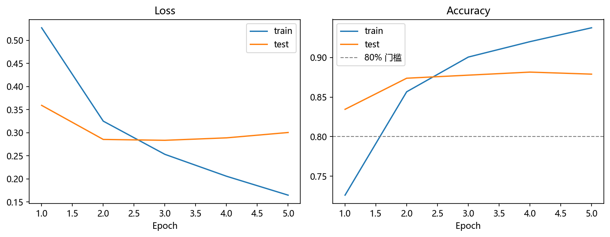
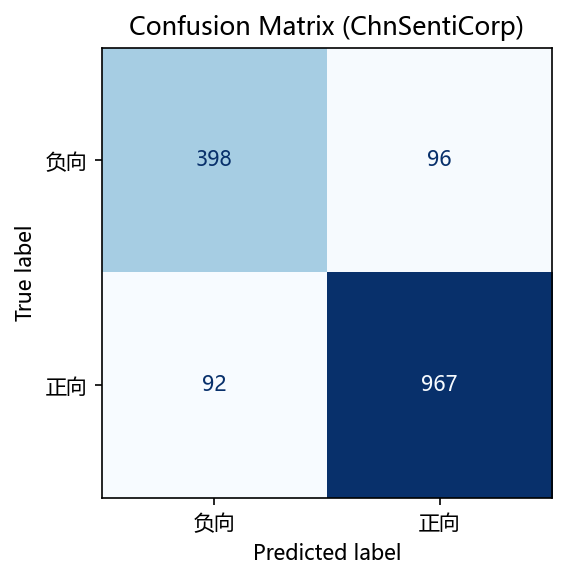
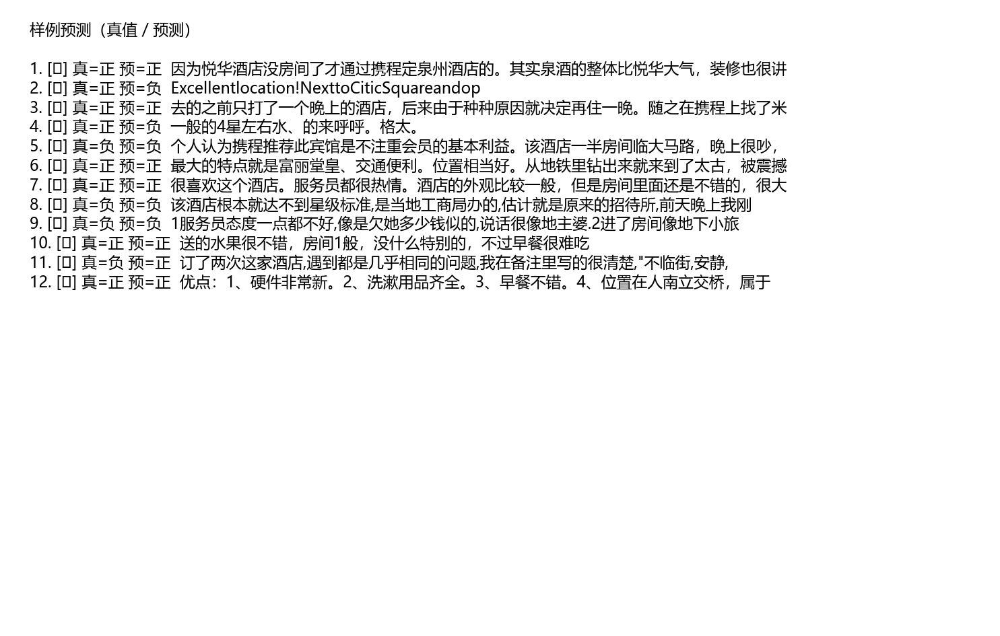

# MindSpore 中文文本分类（情感）

基于 **MindSpore 2.10.0（Windows CPU）** 的中文酒店评论情感二分类项目。  
数据集：**ChnSentiCorp**；主模型：**TextCNN**（可选 BiLSTM 对比）。

> 训练营大作业选题 **A** · 目标基础分 **20** · **不做教学视频**  
> README 写法参考：[GPT-SoVITS-mindspore](https://github.com/ultranationalism/GPT-SoVITS-mindspore)（仅学交付结构，不照搬语音栈）

---

## 项目简介

| 项 | 说明 |
| --- | --- |
| 任务 | 中文评论 → 正向 / 负向 |
| 数据 | ChnSentiCorp 酒店评论（公开 CSV，首次运行自动下载） |
| 模型 | **TextCNN**（默认）；`--model bilstm` 可选 |
| 分词 | **字级**（无 jieba，依赖少、CPU 稳） |
| 达标 | 测试准确率 **≥ 80%**（完整数据 + 5 epoch 通常可达 ~85%+） |

### 为何选 TextCNN 而不是 BERT？

- Windows **CPU** 上 TinyBERT / mindnlp 依赖重、版本易冲突、训练慢。  
- TextCNN 参数量小、收敛快，ChnSentiCorp 二分类对作业门槛足够。  
- 单 notebook 即可端到端，适合上传华为云 **AI Gallery**。

---

## 环境要求

| 项 | 版本 |
| --- | --- |
| OS | Windows 10/11 |
| Python | **3.10**（conda 环境名建议：`ms_docs_try`） |
| MindSpore | **2.10.0 CPU**（已安装可跳过） |
| 设备 | `CPU`（本仓库默认） |

安装 MindSpore（若尚未安装）：见 [官方安装指南](https://www.mindspore.cn/install)。

---

## 快速开始

```bat
:: 1. 激活环境
conda activate ms_docs_try

:: 2. 进入仓库根目录后安装依赖
pip install -r requirements.txt

:: 3a. 推荐：跑主 notebook（Gallery 友好）
jupyter notebook notebooks/train_eval.ipynb
:: 菜单: Kernel → Restart & Run All

:: 3b. 或命令行
python train_eval.py --epochs 5 --model textcnn
```

首次运行会自动下载 `data/ChnSentiCorp_htl_all.csv`。若下载失败，请手动保存到 `data/`（地址见 notebook / `src/data.py`）。

---

## 目录结构

```text
.
├── README.md
├── requirements.txt
├── train_eval.py              # 可选 CLI
├── notebooks/
│   └── train_eval.ipynb       # 主入口（数据→训练→评估→出图）
├── src/
│   ├── data.py                # 下载 / 字级编码
│   ├── model.py               # TextCNN / BiLSTM
│   ├── train.py               # 训练评估
│   └── viz.py                 # 曲线与混淆矩阵
├── data/                      # 数据集（gitignore，运行时下载）
├── checkpoints/               # 最优权重与词表
└── assets/demo/               # 结果图（训练后生成）
```

---

## 预期指标

| 设置 | 测试准确率 |
| --- | --- |
| TextCNN，字级，max_len=100，4 epoch，batch=64 | **约 88%**（Agent CPU 实测 `0.8802`） |
| 默认 5 epoch（本机 Windows） | 目标 **≥ 80%**（常见 85%～90%） |
| 若 <80% | 增至 8～10 epoch，或 `--embed-dim 192`，确认 CSV 完整 |

训练结束后控制台会打印最终准确率；图写入 `assets/demo/`。

---

## Demo 图片

仓库已附一次训练产物（本机复现后可覆盖）：







生成说明见 [`assets/demo/README.md`](assets/demo/README.md)。

---

## 上传 AI Gallery

1. 本地确认 notebook **Restart & Run All** 通过且准确率 ≥80%。  
2. 将 `notebooks/train_eval.ipynb`（可含运行输出）上传至  
   [华为云 AI Gallery](https://pangu.huaweicloud.com/gallery/article-detail.html?id=0bcd0406-e133-4c0b-83e0-83ec4c41669d)（需登录）。  
3. 提交材料保留 GitHub 链接 + Gallery 链接。  
4. **不需要**教学视频。

---

## 已知问题

- Agent / Linux CI 环境可能无 MindSpore Windows 轮子；**请在本机 `ms_docs_try` 跑通**。  
- 自动下载依赖 GitHub raw；网络受限时请手动放置 CSV。  
- 中文字体缺失时混淆矩阵标题可能显示方块，不影响数值结果（Windows 一般有微软雅黑）。

---

## 参考

- MindSpore 2.10 情感分析教程：https://www.mindspore.cn/tutorials/zh-CN/r2.10.0/nlp/sentiment_analysis.html  
- ChnSentiCorp 数据：https://github.com/SophonPlus/ChineseNlpCorpus  
- 社区中文分类参考：https://github.com/mindspore-courses/chinese-text-classification-mindspore  
